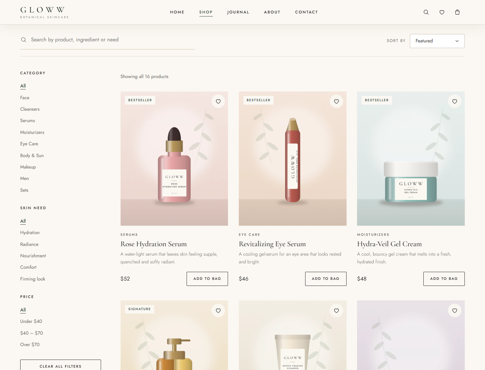
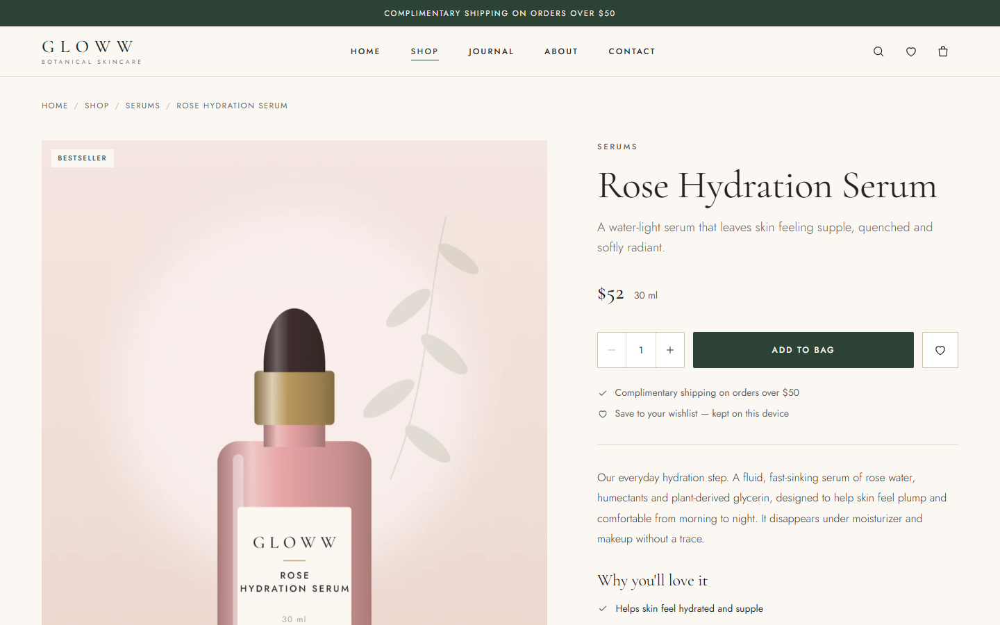
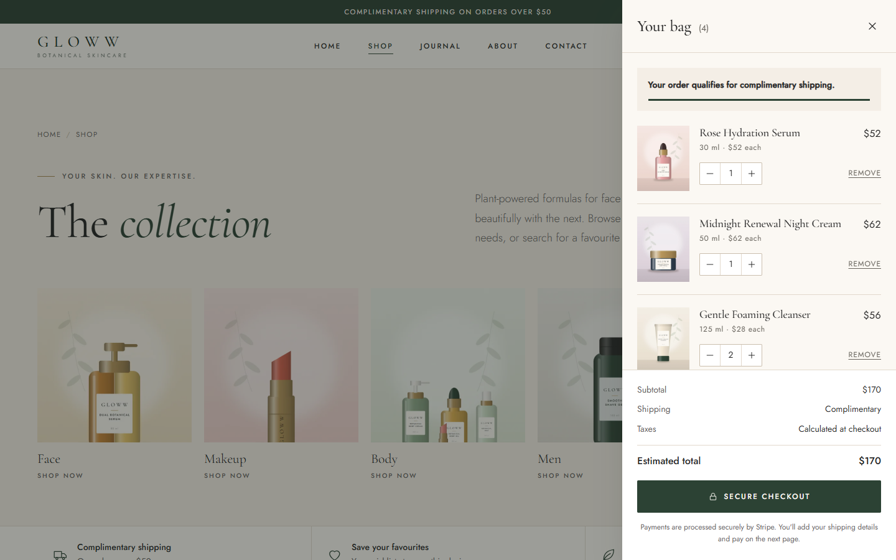

# GLOWW — Skincare E-Commerce Storefront

A responsive storefront for GLOWW, a fictional botanical skincare brand. It's built with plain HTML, CSS and vanilla JavaScript, with no framework, no build step and no npm packages. Payments, newsletter sign-up and the contact form run through four small Netlify Functions that call Stripe, Mailchimp and Resend.

**[Live demo](https://gloww-skincare-6bb719.netlify.app/)** · **[Source code](https://github.com/FaizahYusuf/gloww-skincare)**


<table>
  <tr>
    <td width="50%"></td>
    <td width="50%"></td>
  </tr>
  <tr>
    <td align="center"><sub>Shop: search, filters and sorting</sub></td>
    <td align="center"><sub>Product detail page</sub></td>
  </tr>
  <tr>
    <td width="50%"></td>
    <td width="50%" align="center"></td>
  </tr>
  <tr>
    <td align="center"><sub>Shopping bag drawer (sample items)</sub></td>
    <td align="center"><sub>Mobile layout</sub></td>
  </tr>
</table>

> GLOWW is an original brand made for this project. Product names, copy and packaging artwork are original. The packshots are generated by `tools/generate-packshots.py`. The homepage reviews are clearly labelled on the site as illustrative samples.

---

## Features

**Shopping**
- A catalog of 16 products across 8 categories, defined in one file (`js/products.js`). Every page reads from it, and so does the checkout function.
- Shop page:
  - Live search by product, ingredient or skin need.
  - Filters for category, skin need and price range, with a "clear all" option.
  - Four sort orders and a no-results state.
  - Filter state is kept in the URL, so filtered views can be shared and bookmarked.
- Product detail pages with benefits, key ingredients, how-to-use, a quantity selector and related products. The image area becomes a thumbnail gallery when a product has more than one image.
- A quick-view dialog for adding products to the bag without leaving the grid.
- Shopping bag:
  - Change quantities, or remove items with an undo option.
  - A live subtotal and a free-shipping progress message.
  - Contents persist in `localStorage`.
- A wishlist with a drawer view and a "move to bag" action, also kept in `localStorage`.
- A site-wide search overlay: press `/` to open it, then use the arrow keys to move through results.

**Payments and integrations**
- **Stripe Checkout.**
  - The browser sends only product ids and quantities.
  - The server function rebuilds every price and the shipping charge from the catalog, and ignores any totals sent by the browser.
  - Card details are entered on Stripe's hosted page.
- **Order confirmation.** `checkout-success.html` loads the order from Stripe and clears the bag only once Stripe reports it as paid.
- **Newsletter.** Sign-ups go to Mailchimp through a serverless function, with double opt-in on by default.
- **Contact form.** Messages are emailed through Resend, with the visitor's address set as Reply-To.
- **Form handling.**
  - Client- and server-side validation, plus a honeypot field against spam.
  - Loading, success and error states.
  - Clear messaging when the site runs without its backend.

**Quality**
- Accessibility:
  - Semantic HTML and a skip link on every page.
  - A keyboard-accessible mobile menu.
  - Bag, wishlist, search and quick view use the native `<dialog>` element, which provides focus handling and Escape to close.
  - Visible focus states throughout.
- Motion: subtle scroll reveals and a hero slideshow with a pause control. When the visitor's system asks for reduced motion, the reveals are skipped and the slideshow doesn't autoplay.
- Performance:
  - Responsive WebP images (480 px / 960 px / full size) with lazy loading.
  - Self-hosted fonts and no third-party scripts.
- SEO: unique titles and meta descriptions, Open Graph tags, `sitemap.xml`, `robots.txt` and a branded 404 page.

## Tech stack

| Area | Used |
|---|---|
| Frontend | HTML5, CSS3 (custom properties, Grid, Flexbox), vanilla JavaScript (classic scripts, no modules) |
| Backend | Netlify Functions (Node.js ES modules, using the standard `Request`/`Response` objects, no npm dependencies) |
| Payments | Stripe Checkout (REST API) |
| Email | Mailchimp Marketing API (newsletter), Resend (contact form) |
| Hosting | Netlify (static site + functions) |
| Dev tooling | Python scripts for image optimization and packshot generation (not needed to run the site) |

---

## Project structure

```
├── index.html               Homepage
├── Product.html             Shop: search, filters, sorting
├── product-detail.html      Product page (?p=<product-id>)
├── about.html, journal.html, contact.html
├── checkout-success.html    Order confirmation after Stripe (noindex)
├── 404.html                 Branded "page not found"
├── navbar.html              Internal design-system reference (noindex)
├── css/
│   ├── base.css             Design tokens, typography, buttons, forms, dialogs, footer
│   ├── navbar.css           Shared header and mobile navigation
│   └── index.css, products.css, about.css, content.css   Page styles
├── js/
│   ├── products.js          Product catalog and store config (also imported by checkout)
│   ├── store.js             Bag and wishlist state (localStorage)
│   ├── script.js            Shared helpers, header, mobile menu, scroll reveals
│   ├── drawers.js           Bag, wishlist, search overlay, quick view
│   ├── shop.js, product.js, home.js, slideshow.js
│   ├── forms.js             Newsletter and contact forms
│   └── checkout-success.js  Order confirmation page
├── netlify/
│   ├── functions/
│   │   ├── create-checkout-session.mjs   POST /api/create-checkout-session
│   │   ├── checkout-status.mjs           GET  /api/checkout-status
│   │   ├── newsletter-subscribe.mjs      POST /api/newsletter-subscribe
│   │   └── contact-submit.mjs            POST /api/contact-submit
│   └── lib/http.mjs         Shared response helpers
├── Images/                  Photography, optimized WebP copies, product packshots
├── fonts/                   Cormorant Garamond and Jost (SIL Open Font License)
├── tools/                   Image optimization and packshot generation scripts
├── screenshots/             README images
├── netlify.toml             Publish folder, functions directory, blocked internal paths
└── .env.example             Environment variable names (no values)
```

Every page loads its scripts in the same order: `products.js` → `store.js` → `script.js` → `drawers.js` → the page's own script.

---

## Running locally

**Static preview.** You only need Python, or any other static file server.

```bash
git clone https://github.com/FaizahYusuf/gloww-skincare.git
cd gloww-skincare
python -m http.server 8000
# open http://localhost:8000
```

Browsing, search, filters, product pages, the bag and the wishlist all work. Checkout, the newsletter and the contact form need the serverless functions, and the site tells you when they're unavailable.

**Full stack with functions.** This needs Node.js and the [Netlify CLI](https://docs.netlify.com/cli/get-started/), a developer tool that isn't part of the project.

```bash
npm install -g netlify-cli
cp .env.example .env      # fill in TEST credentials — .env is git-ignored
netlify dev               # http://localhost:8888, including /api/* routes
```

### Environment variables

[`.env.example`](.env.example) lists every variable, without values. Locally they go in `.env`. In production they're set in **Netlify → Site configuration → Environment variables**, and their scope must include Functions.

| Variable | Needed for | Notes |
|---|---|---|
| `STRIPE_SECRET_KEY` | Checkout | Use a `sk_test_…` key for development |
| `STRIPE_SHIPPING_COUNTRIES` | Optional | Comma-separated ISO codes, default `US` |
| `STRIPE_AUTOMATIC_TAX` | Optional | `true` only after Stripe Tax is configured |
| `MAILCHIMP_API_KEY` | Newsletter | The key ends in the data-centre suffix, e.g. `-us21` |
| `MAILCHIMP_AUDIENCE_ID` | Newsletter | Audience → Settings → Audience name and defaults |
| `MAILCHIMP_SERVER_PREFIX` | Optional | Read from the API key if omitted |
| `MAILCHIMP_DOUBLE_OPT_IN` | Optional | `false` subscribes immediately instead of sending a confirmation email |
| `RESEND_API_KEY` | Contact form | A key with sending access |
| `CONTACT_TO_EMAIL` | Contact form | The inbox that receives messages |
| `CONTACT_FROM_EMAIL` | Optional | A sender on a domain verified in Resend. Without one, Resend only delivers to the account owner's address |

Secret keys are only read inside the Netlify Functions. They never appear in frontend code and are never committed.

### Checking an integration

Each function answers a plain `GET` with a health check that reports whether it's configured, without revealing any values:

```bash
curl https://gloww-skincare-6bb719.netlify.app/api/newsletter-subscribe
# {"ok":true,"service":"newsletter-subscribe","configured":true,...}
```

A reply of `"configured": false` means a variable is missing or not scoped to Functions. Function logs in Netlify record a status code for each request, such as `SUBSCRIBED`, `NOT_CONFIGURED` or `MAILCHIMP_AUTH_FAILED`. Visitors only ever see friendly messages.

---

## How checkout works

1. The visitor clicks **Secure checkout** in the bag. The browser posts product ids and quantities to `/api/create-checkout-session`.
2. The function validates the request: no unknown products, invalid quantities, duplicates, or more than 20 lines. It then prices each line from `js/products.js` and works out shipping: free over $50, otherwise $6.95.
3. Stripe creates a Checkout Session, and the visitor is redirected to Stripe's hosted payment page.
4. Stripe redirects back to `checkout-success.html?session_id=…`. That page fetches the order summary from `/api/checkout-status` and clears the bag only if Stripe reports it as paid.
5. If the visitor cancels, they return to the shop with their bag intact.

For testing, use Stripe test keys and the test card `4242 4242 4242 4242`, with any future expiry date and any CVC.

---

## Deployment

The site is deployed on **Netlify**. `netlify.toml` publishes the project root as-is, since there's no build command. It also sets `netlify/functions` as the functions directory and returns 404 for internal paths such as `tools/`, `netlify/` and `README.md`.

To deploy your own copy:
1. Import the repository in Netlify (**Add new site → Import an existing project**), or deploy from the project folder with the Netlify CLI.
2. Add the environment variables listed above.
3. Deploy, and check each function with the health check above.

Only switch `STRIPE_SECRET_KEY` to a live key once you're ready to take real payments.

---

## Known limitations

- **No order database or webhooks.** Paid orders are managed in the Stripe Dashboard, and fulfilment isn't automated.
- **No customer accounts.** The bag and wishlist are stored in the visitor's browser on one device and don't sync between devices.
- **Sample reviews.** The homepage reviews are illustrative and labelled that way on the site; there's no review system yet.
- **Legal pages.** Terms of sale, a privacy policy and a final returns policy would be needed before taking live payments.

---

## Credits

- Fonts: [Cormorant Garamond](https://fonts.google.com/specimen/Cormorant+Garamond) and [Jost](https://fonts.google.com/specimen/Jost), SIL Open Font License 1.1.
- Product packshots: generated for this project by `tools/generate-packshots.py`.

## License

No open-source license has been chosen yet, so all rights are reserved by the author. If you'd like to reuse this code, please get in touch through GitHub: [@FaizahYusuf](https://github.com/FaizahYusuf).
